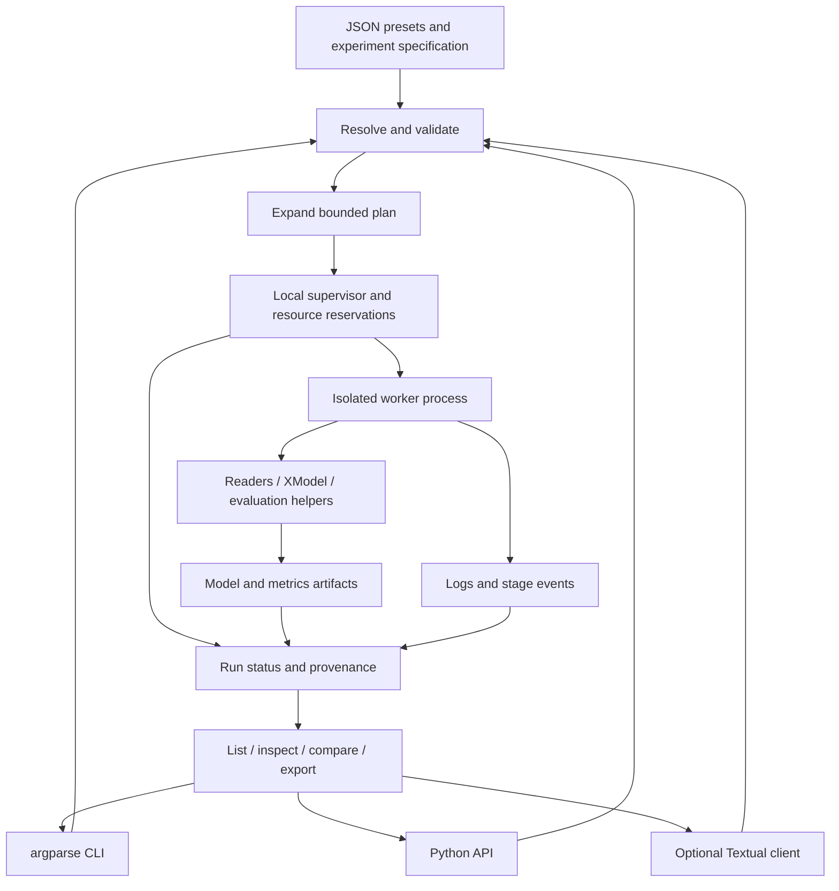

# Experiment management design for this fork

Historical design and baseline inventory. For current implementation and cleanup decisions, see
[architecture assessment](../architecture.md); the registry names and line numbers below describe older code.

Analysis baseline: local commit `7683b5dc5180d7f3f5c80008ab579d65ae9e8266`, inspected on 2026-10-09. The working tree was clean before this report. Only this fork informs the design; the upstream repository is outside scope.

**Since that commit (Plan H, 2026-10-09):** `scripts/run_experiment.py` writes `status.json` (running / completed /
failed), `spec.json`, `git.json` and `provenance.json` per run, and transformer configs accept `kwargs.revision`
(pins the Hub checkpoint and joins the embedding cache key when set; the two main configs leave it unset). § A describes
the code at the baseline commit, not these additions.

**Recommendation:** build a small experiment management layer around the existing pipeline: JSON presets and batch specifications, Pydantic validation, a Python API, an argparse CLI, and local file tracking. Execute isolated worker processes sequentially first. Add bounded parallel execution next, and an optional Textual client last. Do not start with Hydra, MLflow, a distributed orchestrator, or a TUI containing training logic.

The smaller first release is one validated run plus saved metrics and provenance. It should establish the same contracts that batches will use.

This is a design report, not an implementation. All new modules, specification fields, APIs, and `xmr4el ...` commands below are proposed. Current commands are identified explicitly.

## A. Current architecture

### Entry points and configuration

| Operation | Implemented entry point | Behavior |
| --- | --- | --- |
| Train | [`scripts/train.py`](../../scripts/train.py), `main`, lines 16–60 | argparse; load one model JSON; load and group local data; take first `ds_len` groups; call `XModel.train`; save under `outputs/saved_trees`. |
| Evaluate | [`scripts/evaluate.py`](../../scripts/evaluate.py), `main`, lines 26–110 | Load one tree; parse PubTator evaluation data; exclude out-of-vocabulary gold labels; predict; print metrics and optional string/reranker breakdowns. |
| Predict | [`xmr4el/xmodel.py`](../../xmr4el/xmodel.py), `XModel.predict`, line 304 | Python API accepting raw text; returns a query-by-label CSR score matrix. There is no dedicated prediction CLI. |
| Load model | `XModel.load`, line 198 | Load pickled state, hierarchy, and fitted encoder; check label count against PIFA rows. |
| Construct model | `XModel.__init__`, line 43; `load_config`, line 218 | Constructor keyword arguments or JSON unpacked directly into `XModel(**data)`. |
| Train reranker | [`scripts/train_reranker.py`](../../scripts/train_reranker.py), `main`, line 29 | Separate argparse settings; load a saved tree; construct negatives; train a cross-encoder; save under `outputs/rerankers`. |
| Diagnose | [`scripts/diagnose_routing.py`](../../scripts/diagnose_routing.py), `report`; [`scripts/diagnose_unseen.py`](../../scripts/diagnose_unseen.py) | Saved-tree diagnostics, avoiding full retraining. Routing reports include uniform chance and majority-cluster baselines. |
| Sweep search | [`scripts/experiments/beam_sweep.py`](../../scripts/experiments/beam_sweep.py), `run_tests`, line 16 | Sequential subprocess calls to evaluation; continues after a child failure and exits unsuccessfully if any failed. |
| Screen features | [`scripts/experiments/screen_features.py`](../../scripts/experiments/screen_features.py) | Flat retrieval comparisons without tree training; its own feature variants and tie policy. |
| Screen leaf scorers | [`scripts/experiments/screen_leaf_scorer.py`](../../scripts/experiments/screen_leaf_scorer.py) | Oracle routing within saved leaves; standalone scorer mapping, including logistic regression and SVM. |
| PECOS baseline | [`scripts/baselines/pecos_compare.py`](../../scripts/baselines/pecos_compare.py), `export`/`score`; [`pecos_run.py`](../../scripts/baselines/pecos_run.py), `main` | Export aligned matrices, train external PECOS variants, save predictions, report comparisons. Separate runtime. |

[`pyproject.toml`](../../pyproject.toml) declares Python >=3.12 and the ML stack, but no `[project.scripts]` entry point. There is currently no installed `xmr4el` command, dataset catalog, experiment store, or general batch manager.

The two tracked model presets, [`xmr4el_base_config.json`](../../configs/xmr4el_base_config.json) and [`xmr4el_bc5cdr_config.json`](../../configs/xmr4el_bc5cdr_config.json), contain constructor settings only. They repeat most feature and matcher settings. Dataset paths, group limits, output selection, and reranker training settings live elsewhere, principally CLI arguments. There is no inherited configuration or general grid expansion.

Configuration checks are distributed and often late: unexpected top-level fields raise constructor `TypeError`; some factories assert that `type` exists and then index a registry; parameter errors can occur during fitting. `resolve_predict_config` checks beam and top-k bounds but does not provide a complete experiment schema. Factory defaults are also not all materialized in the saved top-level model config.

### Component selection: implemented inventory

| Stage | Existing selection mechanism | Available pipeline implementations |
| --- | --- | --- |
| Feature composition | `FEATURES` and `TextEncoder._encode` in [`features/encoder.py`](../../xmr4el/features/encoder.py) | `tfidf`, `sapbert_char_context`. |
| Vectorization | `vectorizer_dict`, `VectorizerMeta`, `Vectorizer.fit` in [`features/vectorizers.py`](../../xmr4el/features/vectorizers.py) | `tfidf`. |
| Reduction | `dimension_dict`, `DimensionModelMeta`, `DimensionModel.fit` in [`features/reduction.py`](../../xmr4el/features/reduction.py) | `sklearntruncatedsvd`. |
| Frozen transformer | `MODEL_NAMES`, `Transformer.transform`, `sentence_model` in [`features/transformers.py`](../../xmr4el/features/transformers.py) | `biobert`, `sentencetbiobert`, `sapbert`; arbitrary checkpoint through `kwargs.model_name`, with optional pooling and max length. |
| Label representation | `XModel._fit` and [`LabelEmbeddingFactory.generate_PIFA`](../../xmr4el/features/label_embeddings.py) | PIFA, hard-coded by the pipeline rather than a selectable registry. |
| Clustering | `cluster_dict`, `ClusterMeta`, `ClusteringModel.train` in [`hierarchy/clusterers.py`](../../xmr4el/hierarchy/clusterers.py) | `balancedkmeans`. |
| Matcher | `classifier_dict`, `ClassifierMeta`, `ClassifierModel.train` in [`learning/classifiers.py`](../../xmr4el/learning/classifiers.py) | `jointlogisticregression`, backed by `JointOvRLogistic`. |
| Leaf scoring | `MLModel.train`, `HierarchicalMLModel.predict` | Label-level matcher probability multiplied by routing path probability; optional mention-kNN in `XModel.predict`. |
| Cross-encoder | [`rerank.py`](../../xmr4el/rerank.py), `CrossEncoderReranker` | Separate training/evaluation stage, not a constructor-selected leaf ranker. |

Metaclasses register lower-case subclass names when their modules are imported. They are useful existing extension points, but do not discover unimported modules or provide parameter schemas, resource requirements, compatibility rules, or user-facing descriptions. `JointOvRLogistic` is the estimator behind the registered wrapper, not a second pipeline backend.

Do not expose standalone screen scorers as if they were interchangeable tree components. There is no current independent `ranker_config`, separate routing/leaf matcher configuration, or configurable label embedding method. Adding those is model research work, separate from experiment management.

### Verified execution flow

1. **Load and group.** `train.main` calls `Preprocessor.load_pubtator_file` and `organize_pubtator_output`, or `load_data_labels_from_file` in [`data/readers.py`](../../xmr4el/data/readers.py). PubTator produces supplied mentions plus context, optional document abbreviation expansion, labels, spans, and document IDs. Training groups mentions by label. TSV rows are `group_id<TAB>text`, with a separate label file aligned to sorted group IDs.
2. **Select training groups.** `-ds_len` slices groups after loading the corpus. PubTator groups preserve first-seen label order; TSV uses sorted group IDs. This is neither random sampling nor a document/mention limit, and does not bound initial loading memory. TSV with non-TF-IDF features is rejected by the training CLI.
3. **Prepare examples.** `XModel._fit` deep-copies training groups and calls `Preprocessor.prepare_data` to flatten synonyms and retain row-to-label ownership.
4. **Fit features.** `TextEncoder.encode` fits training TF-IDF and reduction models. `tfidf` represents the whole input. `sapbert_char_context` requires `[SEP]` and concatenates transformer mention, character TF-IDF/SVD mention, and TF-IDF/SVD context blocks; each block and the concatenated row are normalized. Actual block widths are recorded.
5. **Construct labels.** `LabelEmbeddingFactory.label_binarizer` returns sparse `Y` and sorted classes. `XModel.initial_labels` follows those columns, not input group order. PIFA is normalized `Y.T @ X`, materialized densely as `Z`.
6. **Build hierarchy.** `HierarchicalMLModel.train` in [`hierarchy/tree.py`](../../xmr4el/hierarchy/tree.py), line 208, trains nodes sequentially, layer by layer. `BalancedKMeans.train` bisects normalized label embeddings, then jointly refines balanced assignments. `ClusteringTrainer.train` filters undersized clusters and reassigns orphan labels to valid centroids.
7. **Train matchers.** `MLModel.train` in [`hierarchy/node.py`](../../xmr4el/hierarchy/node.py), line 140, trains internal nodes against `Y @ C`. Leaves use identity `C`, producing label-level supervision. `prepare_layer` passes child rows only from the child cluster and appends three parent score features. There are no out-of-cluster negatives in those child inputs.
8. **Persist.** Each trained node is temporarily saved and later reloaded into the complete hierarchy. `XModel.save` writes the final model to a timestamp-named child of its argument directory.
9. **Infer.** Query features use fitted TF-IDF/SVD models. Batched beam traversal expands internal nodes, with at most 100 candidate labels contributed by each visited leaf. Scores always include routing path probability. Mention-kNN optionally multiplies scores by `exp(beta * max_cosine)` before final top-k truncation.
10. **Evaluate.** `evaluate.main` parses PubTator using the tree's preprocessing, filters to training vocabulary, calls prediction, and uses `gold_rank` and `ranking_metrics` in [`eval.py`](../../xmr4el/eval.py). It reports acc@1, MRR, recall@k, candidate recall, vocabulary coverage, and optionally string breakdowns or cross-encoder reranking.

Training from TSV exists; the evaluation CLI specifically consumes PubTator. A future dataset adapter must explicitly define any flat TSV evaluation format instead of claiming that it already works.

### Logging, persistence, caching, failure handling

- Library modules use Python logging. [`xmr4el/__init__.py`](../../xmr4el/__init__.py) provides package verbosity and a null handler; applications own output handlers. Encoding, hierarchy, node, routing, and ranking logs already contain useful counts and elapsed times. Evaluation and screens mainly print human-readable output. There is no structured progress stream or common metrics JSON.
- `XModel.save`, line 169, safely reserves a unique timestamp directory but returns no path. `xmodel.pkl` retains training groups, label mapping, `X/Y/Z`, and configuration; `xmodel.json` is a readable state summary, never loaded. Encoder, hierarchy, node, clustering, and matcher state are saved separately. Hierarchy saving refuses nonempty destinations, and loading validates child mappings and numeric node order.
- A final model directory is not published atomically as a complete artifact. Save failure can leave a partial directory. Merely finding a directory is insufficient evidence of successful training.
- Temporary node persistence in `HierarchicalMLModel.train` is a memory measure, not a restart checkpoint: temporary folders have no durable resume manifest, and training reconstructs all nodes at the end. Cross-encoder saving stores model/tokenizer/metadata, not optimizer, scheduler, and RNG state for training continuation.
- `Transformer.transform`, line 58, caches embeddings under `outputs/cache/transformers`. The key includes checkpoint name, requested pooling/max length, dtype, and sorted unique input strings. Reordered or repeated rows can reuse that exact unique-text set, with inverse mapping preserving order. A different subset creates a different cache entry; this is not a per-string cache.
- Transformer cache writes use private temporary files and atomic replacement. Readers check row count, but there is no checkpoint revision, tokenizer/library/code fingerprint, expected feature-width check, eviction, or coordination to stop concurrent duplicate computation. The checkpoint is reloaded on cache misses rather than saved with the fitted encoder.
- Frozen embeddings are the only automatic cross-run cache. Fitted TF-IDF/SVD, grouped inputs, and PIFA are recomputed during ordinary training. PECOS exports demonstrate reusable aligned matrices, but are manually produced artifacts, not a general cache.
- Some boundaries validate input lengths, feature formats, search limits, persistence capabilities, and empty clusters. Transformer encoding retries CUDA/MPS OOMs with smaller batches. There is no common run status, failed-stage record, automatic experiment retry, or batch resume. Nonconvergence warns; it is not an exception. Evaluation with no in-vocabulary rows prints a message and returns successfully without metrics.

### Resource behavior and architectural limits

[`torch_device`](../../xmr4el/__init__.py), line 25, automatically selects CUDA, then MPS, then CPU. `Transformer.transform` explicitly discards a configured `device`. `JointOvRLogistic.fit` uses that same accelerator selection when `n * target_count >= 5,000,000`; smaller fits use CPU. **TF-IDF-only training can therefore still use an accelerator.** There is no current explicit CPU-only run contract or GPU assignment parameter.

The joint matcher densifies features with an added bias column and its target indicator matrix, creates dense sign/weight matrices, and runs Torch L-BFGS with history size 10. A feature buffer alone costs approximately `4 * n * (d + 1)` bytes, before target arrays, device copies, optimizer history, retained CSR matrices, and other stages. The accelerator threshold uses target count, not a memory estimate. Matcher OOM has no equivalent batch reduction mechanism.

PIFA is dense `labels * dimensions`; balanced refinement uses dense label-by-cluster scores, including float64 Torch work; layer preparation materializes scores and retains next-layer inputs. Dense-valued feature blocks stored as CSR can be expensive. Saving training state and internal scores increases disk use, and complete model reload still requires substantial memory. `depth=1` creates a root leaf over the whole label vocabulary, potentially a very large dense target problem.

Core hierarchy training has no node process pool or `n_workers` control. NumPy/BLAS and Torch can nevertheless use native threads. `ClassifierModel.train` uses `threadpool_limits(1)`, so an outer BLAS thread budget may be narrowed there; Torch thread settings need explicit measurement/control too. The standalone leaf screen uses `OneVsRestClassifier(n_jobs=-1)` and can consume all CPU cores. Parallelizing runs without accounting for these differences risks oversubscription.

The main Dockerfile supplies Python 3.12 and locked dependencies, with source mounted at runtime. [`pecos.dockerfile`](../../pecos.dockerfile) uses a separate Python 3.10/libpecos environment. Do not import PECOS into the main runner process or mix its environment into the core lock.

### Tests inspected and executed

The current offline suite passed: **43 tests in 23.04 seconds**, using `.venv/bin/python -m pytest tests/ -q`.

Coverage includes readers/splits, normalized feature blocks, mocked transformer ordering/cache/OOMs, balanced clustering, child inputs, joint logistic behavior, mention-kNN, metrics, logging, quiet CLI behavior, label mapping, save/load round trips, tiny cross-encoder fitting, and out-of-fold exclusion by document. Relevant starting points are [`tests/integration/`](../../tests/integration), [`tests/features/test_transformers.py`](../../tests/features/test_transformers.py), [`tests/test_rerank.py`](../../tests/test_rerank.py), and [`tests/test_audit_regressions.py`](../../tests/test_audit_regressions.py). `conftest.py` redirects embedding caches into temporary directories.

These tests do not establish production memory capacity, real accelerator behavior, dataset quality, deterministic pretrained-model execution, or orchestration reliability. Experiment scheduling, durable state, cancellation, retries, configuration composition, and comparison policy have no implemented layer to test yet. No corpus training, dataset inspection, or resource benchmark was run for this report.

## B. Interface and library comparison

Configuration, CLI, and TUI are complementary entry points. None substitutes for an execution and tracking contract.

| Approach | Initial effort | Research usability | Automation and flexibility | Maintenance | Verdict |
| --- | --- | --- | --- | --- | --- |
| One JSON/YAML per run | Low | Clear at first; duplication grows quickly | Scriptable, but manual combinations and naming | Drifting copies | Keep resolved snapshots per run, not handwritten source files per combination. |
| Base presets + batch specs + grids | Medium | Good for quick overrides and repeatable benchmarks | High; explicit supported combinations | Small composition rules need tests | Primary experiment definition. |
| Traditional CLI over shared runner | Low–medium | Good over SSH, scripts, Docker; forms require knowing names | Excellent unattended use | Small if commands delegate | Essential interface. |
| Textual as the primary execution system | High | Convenient browsing and monitoring | Weak unattended story unless another engine is built | UI lifecycle, process control, forms, tests | Do not choose this. |
| Shared runner/API + config + CLI, optional TUI | Medium, then optional UI cost | Covers exploratory and benchmark use | High, with one execution path | Best boundaries; adapters remain removable | Recommended. |

**JSON versus YAML.** Start with JSON: existing presets load directly, snapshots are unambiguous, and no format conversion is needed. Maintain one base per meaningful component recipe and one batch file per research question. YAML makes comments and large specs easier to edit; optionally support equivalent YAML with safe loading, duplicate-key rejection, and the same validation. Do not treat YAML anchors as a second inheritance system. Keep JSON as the canonical resolved artifact format. PyYAML appears transitively in `uv.lock`; declare it directly if application code begins depending on it.

**Validation: choose Pydantic.** Define strict nested envelope models, forbid extra keys, and validate registered component parameters and cross-field constraints before spawning expensive workers. This is a justified direct dependency: useful errors and schema metadata will serve the Python API, CLI, and eventual parameter forms. It is not directly declared or present under that package name in the inspected lock. Pydantic supplies validation, serialization, and JSON schemas; it does not compose experiments or schedule them. [Pydantic model documentation](https://docs.pydantic.dev/latest/concepts/models/).

**Hydra: defer.** Its configuration composition and multirun support are useful when a large configuration hierarchy already exists. Here, two presets, a handful of registered components, and a small local runner do not justify its override language and application lifecycle as a second control system. It also does not solve this fork's GPU arbitration, artifact completeness, metric comparability, or true resume. Reconsider when configuration groups and launcher requirements exceed the explicit resolver below. [Hydra introduction](https://hydra.cc/docs/intro/).

**OmegaConf: defer.** It provides merging, interpolation, and structured configuration. Use it if composition becomes sufficiently elaborate that maintaining a restricted resolver is harder. Do not add OmegaConf, Hydra, and Pydantic together without a demonstrated need; Pydantic handles the proposed envelope, while the initial resolver only needs one base and explicit override paths. [OmegaConf usage](https://omegaconf.readthedocs.io/en/latest/usage.html).

**CLI: choose argparse now.** Existing scripts already use it, and the proposed commands mainly dispatch to services. Subparsers cover the hierarchy without another direct dependency. Typer would make type-hinted command declarations and completion convenient; Click provides mature command groups. Neither improves experiment semantics. Both appear transitively in the current lock but are not direct project dependencies; declare one explicitly if chosen later. Avoid turning every estimator kwarg into a CLI flag. [argparse](https://docs.python.org/3/library/argparse.html), [Typer](https://typer.tiangolo.com/), [Click](https://click.palletsprojects.com/en/stable/).

### Textual suitability

Textual fits **an optional local/SSH control panel** once the services exist. Useful screens are a component/preset browser, dataset selector, validated override editor, batch preview, queue table, run details/log tail, and metric comparison. Multiple selected models should create independent jobs, not an ensemble or a shared mutable `XModel`.

The UI should load the same descriptors and specifications as the CLI, save an ordinary batch file, call the same planner/controller, and read the same run store. It should never call `XModel.train` inside its event handlers or hold trained models. Textual workers can keep log polling and store reads responsive, but training belongs in external processes. Thread worker cancellation does not make arbitrary blocking training interruptible. Workers are tied to UI lifetimes, so the durable supervisor must live outside the app. [Textual workers](https://textual.textualize.io/guide/workers/).

Implementation cost comes from dependent parameter forms, validation feedback, selection state, process lifecycle, bounded log buffers, terminal resizing, and headless UI tests—not from drawing a table. Make a basic JSON override editor available rather than generating a universal estimator form. Resource utilization is optional telemetry; unknown GPU memory must display as unknown, not zero. GPU reservations come from the controller, never from a UI reading a momentarily idle device.

Initial TUI scope: browse, edit/save specification, preview, launch, cancel, watch, compare. Defer remote transport, embedded training debuggers, sophisticated plots, and arbitrary Python plugin loading. Closing the TUI should detach from the supervisor; stopping runs requires an explicit cancel operation. CLI automation must remain usable without installing Textual.

## C. Final recommendation

Use **Option D, delivered incrementally**, with configuration-driven experiments and a standard CLI as its first usable interface.

Reuse `XModel`, the readers, existing registries, metric helpers, persistence, and frozen embedding cache. Extract script-owned loading/evaluation glue into callable functions. Add run identity, validated batch expansion, artifact manifests, and worker isolation around those functions. Keep model research changes out of this layer.

A local Python supervisor plus file artifacts is sufficient for a workstation or one remote server. No dedicated orchestration framework is needed for the current sequential pipeline and small dependency graph. Consider a cluster scheduler or orchestration framework when work actually spans hosts, needs shared resource reservations, or requires reliable distributed recovery. Do not build that infrastructure in advance.

## D. Proposed architecture and integration



Introduce modules as each phase requires them, not all at once:

```text
xmr4el/
  experiments/
    __init__.py     # small public exports
    config.py       # schemas, preset resolution, validation, fingerprints
    runner.py       # load/train/save/evaluate callable operations
    store.py        # atomic metadata, artifact manifests, query/comparison/export
    plan.py         # bounded expansion and train -> evaluation dependencies
    worker.py       # one attempt, seed/resource setup, logging and failure boundary
    scheduler.py    # subprocess supervision, reservations, cancellation, recovery
    catalog.py      # descriptions/validation for existing component registries
  cli.py           # argparse dispatch; no training logic
  tui/             # optional extra, introduced last
    app.py
configs/
  xmr4el_base_config.json         # reuse current model preset
  xmr4el_bc5cdr_config.json       # reuse current model preset
  experiments/                   # research questions, not every generated run
tests/
  experiments/                   # schema, planning, lifecycle and comparisons
outputs/
  experiments/<experiment-id>/<run-id>/
    resolved.json
    provenance.json
    status.json
    attempts/<attempt-id>/
      worker.log
      events.jsonl
      failure.json               # only on failure
      artifacts/model/<saved-tree>/
      artifacts/manifest.json
    evaluations/<evaluation-id>/
      resolved.json
      status.json
      attempts/<attempt-id>/metrics.json
  cache/transformers/            # retain and strengthen existing cache
```

Responsibility rules:

- `config` resolves input into plain validated values; it cannot launch training or download a checkpoint. `catalog` exposes existing component choices and small parameter descriptions; it does not replace the registries.
- `runner` consumes one resolved specification. It returns artifact paths and metric dictionaries; rendering belongs to interfaces. Initially its only model family is XMR4EL. Add an explicit callable adapter when a genuinely different model family arrives; avoid a new inheritance framework now.
- `plan` identifies training variants separately from evaluation variants. `beam_size`, `topk`, and `knn_beta` normally create evaluations of one saved tree, not new training jobs.
- `scheduler` owns launching, exit codes, resource reservations, and durable lifecycle state. `worker` owns ML imports/objects and its event stream. Interfaces only request operations or observe them.
- `store` reads durable records. Each status file has one controller writer and uses atomic replacement; each attempt event log has one worker writer. Comparison does not scrape terminal logs.
- Python use would be `plan = plan_experiments(load_spec(path)); results = run_plan(plan)` for blocking execution. Detached launch returns IDs that `get_run`, `cancel_run`, and `compare_runs` can use. These are proposed API functions.

### Changes to pipeline boundaries

| Existing boundary | Integration | Effect on model behavior |
| --- | --- | --- |
| Preprocessing | Extract training input dispatch from `scripts/train.py`; reuse `Preprocessor`; record grouping policy and selected labels. | No new sampling or text transformation by default. |
| Feature generation | Pass resolved existing constructor fields; keep `TextEncoder`; later persist/reload a complete preparation artifact. | Preserve normalization and fitted train-only TF-IDF/SVD. |
| Label representation | Retain PIFA and sorted class mapping; store mapping digest with matrices. | No alternative embeddings added by the manager. |
| Hierarchy | Keep `HierarchicalMLModel.train` and `MLModel.train`; add stage events if needed. | No new branching, balance constraints, or negatives. |
| Matcher | Keep registered wrapper and shared matcher config; centralize explicit accelerator selection and worker thread budgets. | Resource choice can affect numerical behavior and must be recorded. |
| Inference/evaluation | Extract evaluation assembly into `xmr4el.eval.evaluate_model`; reuse `gold_rank`, `ranking_metrics`, and breakdown helpers. | Preserve current metrics; expose search overrides as evaluation identity. |
| Persistence | Return the created path from `XModel.save`; manager publishes a completion manifest only after successful save. | Preserve saved-tree format; no old-tree compatibility layer. |

## E. Configuration and user workflows

### Composition contract

Use one base model preset plus named model overrides within a batch. A preset is a complete model recipe, not an arbitrary graph of inherited files. Suggested precedence: built-in defaults -> referenced model JSON -> shared overrides -> named model overrides -> model grid value -> explicit invocation overrides. CLI values use JSON literal parsing, never `eval`.

Merge dictionaries recursively; replace lists and scalars; preserve explicit `null`. A `type` change replaces that component's `kwargs` rather than carrying incompatible parameters from the previous implementation. Reject unknown override paths. Relative paths are resolved against their declaring file, normalized in the snapshot, and retain their original declaration for portability. Output location never changes the process working directory.

Keep `context_window` and `abbrev_expansion` in the resolved model dictionary initially because existing saved trees own evaluation preprocessing. The shared model override block is the place to set them once. Do not add a competing preprocessing namespace with divergent values.

The `seeds` axis sets worker Python/NumPy/Torch RNGs and generated clustering/SVD seeds. Imported preset seed values are defaults replaced by that axis. An explicit seed in a named override or invocation may hold a component fixed; show that clearly in the plan and store the full per-component seed map. Seed before cross-encoder construction: its current `fit` seeds after the classification head has already been initialized.

Validation must cover:

- Required train/evaluation paths, local dataset identity/version, format and label-file requirements; positive group limits; nonempty grids and unique model IDs.
- Supported feature/component names and parameter types; `C > 0`, positive tolerances/iterations, valid class weights, positive SVD dimensions/clusters, `depth >= 1`, and valid minimum leaf size.
- PubTator context/abbreviation settings; grouped TSV compatibility; transformer type or explicit checkpoint; pooling, token length, and batch bounds.
- `beam_size >= 1`, `topk >= 0`, finite nonnegative `knn_beta`, positive metric cutoffs; make no-overlap evaluation an explicit failure/empty result, never success with invented zeros.
- Worker/thread/RAM/device budgets, maximum plan size, supported runtime, and write permissions. Report hierarchy size constraints that can be checked after reading labels; actual splitting failures still need runtime handling.

Separate cheap schema/path validation from data-dependent preflight. The former must not fit models. The latter may read metadata or labels and reports costs before launching. Do not promise static validation can predict every clustering outcome or OOM.

Example error: `models.hybrid.grid.matcher_config.kwargs.C[1]: expected a positive number; got -1`. Another: `dataset grouped-demo: features sapbert_char_context requires mention [SEP] context; grouped TSV adapter supports tfidf`.

### Proposed batch specification

This JSON imports an existing preset and generates meaningful combinations without copying its feature dictionaries. Resource numbers are reservations to calibrate with measurement, not measured requirements.

```json
{
  "schema_version": 1,
  "experiment": "routing-and-matcher-screen",
  "datasets": {
    "medmentions": {
      "version": "local-st21pv-splits-v1",
      "train_format": "pubtator",
      "evaluation_format": "pubtator",
      "train": "../../datasets/MedMentions/st21pv/data/corpus_pubtator_train.txt",
      "dev": "../../datasets/MedMentions/st21pv/data/corpus_pubtator_dev.txt",
      "test": "../../datasets/MedMentions/st21pv/data/corpus_pubtator_test.txt",
      "max_label_groups": 500
    },
    "bc5cdr": {
      "version": "local-disease-splits-v1",
      "train_format": "pubtator",
      "evaluation_format": "pubtator",
      "train": "../../datasets/BC5CDR/disease/train.pubtator",
      "dev": "../../datasets/BC5CDR/disease/dev.pubtator",
      "test": "../../datasets/BC5CDR/disease/test.pubtator",
      "max_label_groups": 500
    }
  },
  "defaults": {
    "model_config": "../xmr4el_base_config.json",
    "model_overrides": {"context_window": 10, "abbrev_expansion": "append"},
    "seeds": [0, 1],
    "evaluation": {
      "split": "dev",
      "ks": [5, 10, 20, 50, 100],
      "string_breakdown": true,
      "predict": {"beam_size": 2, "topk": 0, "knn_beta": 0.0}
    },
    "resources": {"device": "auto", "cpu_threads": 4, "ram_gb": 16}
  },
  "models": [
    {"id": "tfidf", "overrides": {"features": "tfidf"}},
    {
      "id": "hybrid",
      "overrides": {"features": "sapbert_char_context"},
      "grid": {
        "matcher_config.kwargs.C": [0.5, 1.0, 2.0],
        "clustering_config.kwargs.n_clusters": [6, 12]
      }
    }
  ],
  "evaluation_grid": {
    "predict.beam_size": [2, 10],
    "predict.knn_beta": [0.0, 10.0]
  },
  "execution": {
    "max_workers": 1,
    "max_jobs_per_accelerator": 1,
    "max_tasks": 160,
    "on_failure": "continue",
    "automatic_retries": 0
  },
  "output_dir": "../../outputs/experiments"
}
```

Proposed location: `configs/experiments/routing-screen.json`; the relative paths above assume that location. Dataset paths are explicit examples based on documented layout, not assertions that those local files exist. Adjust them during preflight. A version label alone is not provenance: execution records file checksums too.

Plan count: `2 datasets * 2 seeds * (1 TF-IDF + 3 C values * 2 cluster counts) = 28 training runs`; four search configurations per tree give 112 evaluations, or 140 tasks. The limit therefore allows this plan. Disabling a grid or selecting one dataset/model/seed creates a smaller plan without another JSON file.

Both models share PubTator preprocessing here. The TF-IDF variant encodes the complete resulting text, whereas the hybrid encodes separate blocks; it is a feature experiment, not the mention-only TSV recipe. Its inherited context/transformer component configs are inactive, should be shown as inactive, and should not inflate its training fingerprint.

For grouped TSV training, an equivalent dataset record uses `train_format: "grouped_tsv"`, `train`, and `labels`; select TF-IDF. Specify PubTator evaluation explicitly if available. A new flat TSV evaluation format requires an adapter and tests in a later phase.

### Commands: existing versus proposed

Current single training/evaluation remains available:

```bash
.venv/bin/python scripts/train.py \
  -train_path datasets/MedMentions/st21pv/data/corpus_pubtator_train.txt \
  -model_config configs/xmr4el_base_config.json -ds_len 500
.venv/bin/python scripts/evaluate.py \
  -xmodel_path outputs/saved_trees/<saved-tree> \
  -test_path datasets/MedMentions/st21pv/data/corpus_pubtator_dev.txt
```

All following commands are proposed after adding `[project.scripts]`:

| Workflow | Proposed invocation | Semantics |
| --- | --- | --- |
| Browse components/datasets | `xmr4el models list`; `xmr4el datasets list --config configs/experiments/routing-screen.json` | List implemented components/presets and explicitly configured local datasets. No scan of raw corpora. |
| One experiment | `xmr4el run --config configs/experiments/routing-screen.json --dataset medmentions --model tfidf --seed 0` | One training configuration plus default evaluation; `run` rejects unresolved training grids. |
| Quick override | `xmr4el run --config configs/experiments/routing-screen.json --dataset medmentions --model tfidf --seed 0 --set model.matcher_config.kwargs.C=2.0` | Validate, show resolved settings, persist the override with the run. |
| Multiple models | `xmr4el batch --config configs/experiments/routing-screen.json --dataset medmentions --model tfidf --model hybrid` | Expand only selected model recipes; each is independent. |
| Generate/review batch | `xmr4el batch --config configs/experiments/routing-screen.json --dry-run --write-plan outputs/routing-plan.json` | Validate all variants, show counts/dependencies/resource reservations, write a frozen plan. No training. |
| Launch frozen batch | `xmr4el batch --plan outputs/routing-plan.json` | Check code/data identities and execute sequentially initially. |
| Monitor | `xmr4el runs show RUN_ID`; `xmr4el runs logs RUN_ID --follow` | Read stored status, stage, timings, and worker logs. |
| Cancel | `xmr4el runs cancel RUN_ID` | Controller requests termination, escalates after a grace period, records cancellation and incomplete artifacts. |
| Retry | `xmr4el runs retry RUN_ID` | New attempt under the same immutable run specification; preserve failed logs. Completed verified training can survive failed evaluation. |
| Resume batch | `xmr4el batch --plan outputs/routing-plan.json --resume` | Reconcile state, skip verified completed tasks, retry eligible failed/interrupted tasks. No optimizer continuation implied. |
| Evaluate saved tree | `xmr4el evaluate --model-path outputs/saved_trees/<saved-tree> --dataset medmentions --config configs/experiments/routing-screen.json --split dev --beam-size 10 --knn-beta 10` | Create a tracked evaluation; do not retrain. Existing external artifacts receive provenance as available, not fabricated history. |
| Compare/export | `xmr4el runs compare RUN_A RUN_B --split dev --csv outputs/comparison.csv` | Require an unambiguous evaluation selection; show coverage and compatibility alongside metrics. |
| Interactive client | `xmr4el tui --config configs/experiments/routing-screen.json` | Optional later interface over identical services and records. |

`run` uses default evaluation settings rather than the batch's `evaluation_grid`; `batch` expands that grid. To run one hybrid variant, pin both training grid paths with invocation overrides. Dry-run output must make these rules visible.

When a run has several beam/beta evaluations, `runs compare` must accept evaluation IDs or explicit search filters and reject ambiguous selections; it cannot silently choose the highest dev score. Hyperparameters are selected on dev. A frozen chosen configuration is evaluated on test separately, without a test grid used for selection.

## F. Orchestration, reproducibility, and implementation roadmap

### Execution strategy

**Start with sequential isolated subprocesses.** A new process per training attempt prevents package logging, model state, RNGs, native memory, and CUDA contexts from leaking across configurations. Use argument arrays, `sys.executable`, and a resolved specification file, not shell-generated command strings or forked live CUDA objects. Evaluation may stay in the same worker immediately after training to avoid loading another copy; record each evaluation independently.

**Then add bounded parallelism.** Reserve worker RAM, CPU thread budgets, and accelerator slots before launching. One job per accelerator by default, including MPS, which shares system memory. Evaluate RAM pressure across the whole job, not only embedding batches. An `auto` device request may claim an available accelerator; an explicit accelerator requirement must wait or fail if unavailable, not silently fall back. CPU-only must become enforceable before offering mixed scheduling.

Add an explicit selection override to `torch_device` used by transformer, matcher, and reranker paths. The worker can supply a validated process environment setting; CUDA assignment also uses `CUDA_VISIBLE_DEVICES` before imports. Hiding CUDA alone does not disable MPS. Record requested and actual devices, including the matcher's smaller CPU fits. Reserve an accelerator for the complete run first; phase-aware release is a later optimization.

Set native thread environment variables before worker imports and Torch thread counts after import. Retain existing classifier limits until measurements justify changes. Do not run the `n_jobs=-1` screen inside a parallel batch without making its worker count obey the reservation. RAM reservations are admission estimates, not portable hard limits; Linux containers can impose limits when required. GPU memory remains a measured constraint, with reservations and OOM failure handling rather than a universal hard cap.

**Dependencies stay small:** train -> evaluations; optionally candidate generation -> reranker train -> reranker evaluations. Fold-based reranker candidates currently train additional trees sequentially in `out_of_fold_top_k`; include that multiplied cost in planning. Add tracked fold/candidate tasks only when recovery or reuse is needed. PECOS uses a separate external worker/container and aligned exported matrices; it is not a core-package component.

**Lifecycle:** queued -> running -> succeeded / failed / cancelled / interrupted. Store current stage, attempt identity, owner host/process identity, timestamps, heartbeat, and failure stage/type/message/traceback/exit code. Unexpected worker death is failure/interruption, never a permanently running record. Controller restart reconciles process identity and manifests before retry; PID alone is insufficient because it can be reused.

**Cancellation and detachment:** signal only controller-owned process groups after verifying identity; allow a grace period, then terminate. Mark incomplete outputs invalid. A separate supervisor process owns the queue so closing a TUI or log viewer does not cancel experiments. Initially the CLI can run the supervisor in the foreground; remote unattended use can use the existing detached Docker workflow. Add native detached mode before promising TUI-independent launches. Remote viewing initially means running the same CLI/TUI over SSH on the host; no remote API is required.

**Retry policy:** default automatic retries to zero. Invalid configurations and deterministic memory failures should not loop. Manual retry preserves history. Optional bounded retries can later target identified transient failures. Editing configuration, checkpoint revision, code, or dataset creates a new run identity, not an invisible retry of the old experiment.

### Safe artifact reuse and resume

| Artifact | Required identity | Recommended initial behavior |
| --- | --- | --- |
| Parsed/grouped rows | Data bytes, loader/code version, format, context/abbreviation settings, group selection and order | Recompute initially; cache when parsing is measured expensive. |
| Frozen embeddings | Exact unique texts, checkpoint/tokenizer revision, effective pooling/max length, dtype and embedding code/environment policy | Reuse existing cache after strengthening keys/metadata; record hits/misses. |
| Fitted encoder and `X/Y/Z` | Training data/order/vocabulary, all active feature/reduction params and seeds, preparation code, block widths | Add a complete immutable preparation artifact in phase 3. Reuse only exact matches. |
| Tree | Preparation fingerprint, hierarchy/matcher settings and seeds, relevant code/environment identity | Reuse a verified final model for new evaluations; no broad automatic cross-batch reuse at first. |
| Evaluation | Tree artifact digest, evaluation data/order, preprocessing, beam/top-k/beta, metric/tie/filter policy | Skip only matching completed evaluations. |
| Reranker/candidates | Tree and label-text identity, candidate search settings, fold document assignments, training rows, model init/settings | Track explicit dependency; a tree folder basename is not a strong identity. |

Do not reuse fitted TF-IDF/SVD from another split, or reuse fold preparation fitted on held-out documents. Frozen encoder outputs may be shared across folds when no learned preprocessing crosses the boundary. Copying the complete preparation bundle is safer initially than sharing mutable live model objects.

For phase 3, split `XModel.train` into reusable preparation and hierarchy-fitting operations while preserving `train` as the public convenience method. A preparation artifact must carry the fitted encoder, training groups, matrices, sorted label IDs, actual feature widths, and manifest. Never swap only `X` into a model with a different `Y` ordering or TF-IDF vocabulary. Child routing-score features depend on parent matchers and cannot be reused merely because base features match.

Publish cache/artifact completion atomically after validating shapes and mappings. A per-key producer reservation can avoid concurrent duplicate work; atomic cache writes alone only prevent partial files. Track references so cache cleanup never removes artifacts needed by a resumable run.

Resume initially means **restart incomplete stages from verified complete artifacts**. If evaluation fails after model publication, reload the model and repeat evaluation. If training fails midway, restart training, benefiting from valid caches. Persistent per-node training resume is optional and requires durable child input/mapping/config manifests; current temporary node files are insufficient. Cross-encoder optimizer continuation requires optimizer/scheduler/RNG state, epoch/step, and data/candidate identity; current `save_pretrained` artifacts do not provide it.

### Identity and tracking

Keep separate concepts:

- Experiment ID: named research question plus unique batch identity; resolved plan links its members.
- Run ID: unique ID for one dataset/model/training-seed specification. A deterministic fingerprint helps locate equivalent configurations but must not prevent repeated measurements.
- Attempt ID: unique execution/retry of that immutable run. Failed attempts stay available.
- Evaluation ID: identity of tree + split/data + search + metric policy, with its own attempts.

Record resolved settings and referenced preset contents, Git commit and dirty patch digest/content, interpreter/package versions and lock hash, transformer/tokenizer resolved revisions, dataset checksums and declared versions, split/group selection and actual vocabulary digest, all RNG seeds, OS/hardware/devices, thread counts, controller/worker command, stage durations, warnings, cache hits, peak memory when measurable, and artifact hashes.

Model settings requested and settings actually used are distinct: factories fill defaults, SVD may be skipped or return fewer columns, OOM recovery changes embedding batch size, and cluster counts can shrink. Store both effective state and requested snapshot. A warm cache changes runtime interpretation; report encoding, hierarchy, load, prediction, and total durations separately. The GPU threshold was calibrated in comments on MPS, not established as a portable CUDA optimum.

A clean commit and lock hash improve reproducibility but are not a complete environment: capture installed package versions, driver/device details, pretrained revisions, and dirty state. A live Docker source mount can change mid-run; use a frozen checkout for unattended benchmarks. Seeded execution reduces variation but does not guarantee bitwise agreement across CUDA/MPS/CPU or library versions.

### Comparison contract

Metrics JSON should include `acc@1`, `MRR`, `R@k`, candidate recall, total/eligible/excluded row counts, vocabulary coverage, evaluated-row digest, vocabulary digest, search settings, timing/cache state, and warning/failure information. Record seen/unseen string group counts and scores when requested. Routing diagnostics must retain chance `1/K` and majority/fixed-top-k baselines beside measured routing scores.

Default comparisons group by dataset bytes/split and metric/filter/tie policy. Conditional metrics with different vocabularies or evaluated-row sets must be flagged and cannot be treated as directly comparable. Offer an explicit common-row evaluation later; it requires stored row identities or re-evaluation, not averaging incompatible numbers. Aggregate seeds only across matching non-seed settings, state sample count and dispersion, and do not silently choose the best retry or seed.

Keep oracle leaf scores, flat feature-screen metrics, tree metrics, dictionary hybrids, and reranker results labeled as different evaluation protocols. Feature screening currently uses expected random tie metrics, whereas tree `gold_rank` uses stable CSR tie order. Store that difference. Candidate recall is measured after the configured truncation; top-k can alter its meaning. For this reader's one-gold rows, optional all-row metrics can count out-of-vocabulary rows as misses, but must be labeled separately from the current conditional metrics.

Use per-run JSON/JSONL plus CSV/JSON export initially. Scan small metadata files, not model pickles. Add a rebuildable SQLite index only when scans are slow or concurrent querying warrants it; do not create two competing authoritative stores. Avoid SQLite WAL assumptions on a shared network filesystem.

MLflow could provide searchable runs, metric visualizations, artifact logging, and a shared tracking service when collaboration or volume warrants it. It can be used locally too; a server is not mandatory. It would still need explicit logging for this custom hierarchy and would not implement the proposed scheduler or resume semantics. Adopt it as an optional tracking/export adapter when those benefits outweigh dependency and storage lifecycle costs. [MLflow tracking documentation](https://mlflow.org/docs/latest/ml/tracking/).

### Prioritized implementation phases

| Phase | New modules | Existing files to modify | Acceptance checks |
| --- | --- | --- | --- |
| 1 — essential single-run contract | `experiments/config.py`, `runner.py`, `store.py`, `__init__.py`; `cli.py` | `xmr4el/xmodel.py`: return saved directory; `xmr4el/eval.py`: return structured evaluation results; `scripts/train.py` and `scripts/evaluate.py`: delegate shared operations, preserve flags; `pyproject.toml`/`uv.lock`: direct validation dependency and console entry point | Strict config errors before fitting; offline train/save/load/evaluate parity; resolved/provenance/metrics artifacts; failed/no-overlap evaluation recorded honestly; no overwrite. |
| 2 — essential batching and lifecycle | `experiments/plan.py`, `worker.py`, `scheduler.py`, `catalog.py` | `xmr4el/__init__.py`: enforce device override; `scripts/experiments/beam_sweep.py`: delegate tracked eval sweep; `xmr4el/hierarchy/tree.py` only if structured node progress is required | Deterministic expansion/count limits; sequential workers; process death/cancel/retry; completed train survives eval failure; stage manifests; list/compare/export; resource/device isolation. |
| 3 — measured efficiency improvements | Preparation manifest/cache helpers within existing modules; avoid a separate cache service | `xmr4el/xmodel.py`: preparation/hierarchy boundary; `features/transformers.py`: revision-aware keys and configurable cache location; `hierarchy/tree.py`: stage events if still needed; standalone screens only when scheduling them | Exact cache invalidation on text/order/label/seed/revision changes; no split leakage; preparation parity; bounded concurrency and no accelerator double booking. |
| 4 — optional model adapters and advanced recovery | Explicit reranker/PECOS adapters when needed; durable checkpoint helpers only with demonstrated cost | `scripts/train_reranker.py`, `xmr4el/rerank.py`: callable stages, pre-init seed, stronger parent identity; `scripts/baselines/pecos_compare.py`, `pecos_run.py`: structured metrics/runtime/resource settings; `screen_features.py`, `screen_leaf_scorer.py`: explicit protocol metadata | Fold exclusion survives reuse/retry; separate PECOS environment; candidates match tree/label identity; checkpoint restores optimizer/RNG if supported. |
| 5 — optional interaction/tracking | `xmr4el/tui/app.py`, optional MLflow adapter | `pyproject.toml`/`uv.lock`: optional extras; CLI: optional TUI command | Headless UI tests; same validation/plans as CLI; logs bounded; app exit detaches; CLI works without optional extras. |

Add `tests/experiments/test_config.py`, `test_plan.py`, `test_store.py`, and `test_lifecycle.py` as their behaviors appear. Test merging/type changes, seed policy, stable hashes, ambiguous comparisons, atomic completion, partial save rejection, worker failure, cancellation, and resume with tiny fake workers. Extend existing persistence/integration tests for `save`'s returned path and metric parity. Use synthetic data, never full corpora, for orchestration tests.

Document new workflows in `README.md`, `scripts/README.md`, and `tests/README.md` when implemented; introduce an actual batch example under `configs/experiments/`. Do not modify existing configs merely to fit a new manager. Saved trees from incompatible model code are retrained, not migrated.

Suggested first experiments after the essential layer works: evaluate one saved tree over beam/beta settings on dev, proving no retraining occurs; then compare two matcher `C` values with fixed data, vocabulary, preprocessing, and seed. These test the management layer before a large Cartesian benchmark.

## G. Significant risks and design traps

| Risk | Consequence | Smallest useful control |
| --- | --- | --- |
| Different vocabulary/eligible rows | Higher conditional accuracy can reflect an easier subset | Always show coverage and row/vocabulary digests; flag incompatible comparisons. |
| Label index drift | Plausible but meaningless metrics and caches | Preserve sorted class mapping; validate every preparation/artifact boundary. |
| Prefix group selection | Biased quick benchmarks mistaken for random samples | Name the policy, save chosen label IDs, keep subsets fixed; seeded sampling is a separate future feature. |
| Configuration duplication/default drift | A reported JSON omits the behavior actually used | Base presets, resolved snapshots, effective parameters/widths, and versioned schemas. |
| Unsupported combinations | Time lost to late errors or UI options that do nothing | Expose actual registry inventory and compatibility validation; no independent ranker controls yet. |
| Dense matcher/feature memory | CPU/GPU OOM or host swapping across parallel runs | Measure one representative run, bound workers, reserve RAM/device, retain SVD and report effective widths. |
| Native thread oversubscription | Parallel execution becomes slower or unstable | Enforce per-worker budgets and remove `n_jobs=-1` when adapting screens. |
| Stale frozen embedding cache | Different checkpoint/code returns old embeddings | Pin resolved revisions and effective tokenizer/pooling settings in the key and manifest. |
| Partial saved models mistaken for checkpoints | Resume loads incomplete state | Completion manifest only after successful persistence; skip by identity plus verified completeness. |
| Reranker leakage or mismatched candidates | Overoptimistic training or invalid artifact reuse | Document-level folds, explicit tree/candidate identity, seed before initialization. |
| In-sample routing features reused across models | Changed matcher silently gets old child inputs | Recompute matcher-dependent augmentation; cache only exact dependency matches. |
| Dev/test selection leakage | Benchmark claims reflect test tuning | Dev grids, freeze chosen configuration, separate final test evaluation. |
| Arbitrary kwargs and silent coercion | Typos accepted or string booleans alter behavior | Strict schemas and explicit component validation; reject unknown paths/fields. |
| TUI owns worker lifetime | Closing a screen ends a valuable run | External supervisor; app only controls/observes durable jobs. |
| Dirty checkout/live source mounts | Logged commit is not the code that ran | Record dirty patch; benchmark against frozen code. |
| Pickle/environment coupling | Untrusted loading or failures after model/code changes | Load trusted local artifacts; record environment/code identity; retrain incompatible trees. |
| Grid explosion and retries | Unbounded compute/disk spend | Dry-run counts, explicit model-specific grids, hard task cap, zero automatic retries initially. |
| Disk growth | Training succeeds but model publication fails | Record artifact sizes, preflight available space, explicit retention rules; never silently delete run history. |

The proposed manager can organize and reproduce experiments without correcting hierarchy quality, child negative supervision, feature balance, or reranker generalization. Those remain measured model experiments, with configuration and evaluation protocols held fixed.

Scope limits: no datasets were opened, no corpus model was trained, no accelerator or Docker benchmark was run, and no experiment interface was implemented. The executed 43-test suite verifies the current fork's offline behavior, not the proposed orchestration layer.
