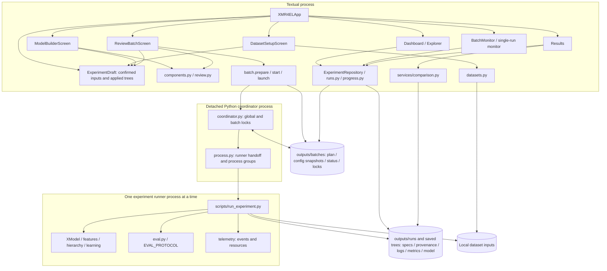

# XMR4EL Code Quality and Architecture Review

Date: 2026-10-30. Reviewed baseline: `3033827` (`TUI: Step 6 audit repairs, acceptance-test fixes, launch confirmation`). The working tree was clean before this review. Line references describe that baseline; implementation agents must relocate symbols if the code changes.

This is an independent assessment and implementation handoff, not a refactoring change. No production code, datasets, saved models, research outputs, or dependencies were modified. The only repository addition is this report.

The review used `AGENTS.md`, `CLAUDE.md` excluding Claude model-selection instructions, `STATUS.md`, relevant README sections, `docs/pipeline.md`, `docs/design/tui_architecture.md`, and `docs/audits/new_experiment_step6.md`. Current implementation takes precedence over those documents. Safe synthetic tests and reproductions supplement inspection; passing tests are not the basis for the architecture verdict.

## A. Executive architecture verdict

**Good architecture with manageable technical debt.** The project does not need substantial restructuring. Its central design is appropriate for local research: one in-memory experiment draft, copied launch plans, an independent sequential coordinator, the existing experiment runner, inspectable filesystem artifacts, and a conservative results-comparison service.

The strongest boundaries are between UI and execution, applied configuration and temporary edits, and recorded metrics and comparison eligibility. The main weaknesses are incomplete configuration contracts and navigation actions that do not consistently respect their screen's transient state.

**Recommend holding V1 for two focused repairs:** inconsistent clustering-default resolution (F1) and a reproducible reorder-cancellation exception (F2). Neither requires a new architecture. Three further findings concern accumulating workflow screens, incomplete unknown-parameter validation, and unused launch scaffolding. No new ARCH-P0 process-termination defect or label-mapping defect was demonstrated.

This recommendation assumes a trusted local checkout on Linux or macOS, small manually assembled batches, and the documented no-automatic-restart policy. It does not certify hostile shared-filesystem operation, Windows, or real biomedical workload performance.

## B. Current architecture map



An edge from the repository to batch files includes **reconciliation writes**: observing a dead coordinator can mark a batch LOST. It is not a strictly read-only repository, despite its `snapshot()` docstring.

### Responsibilities, interfaces, and testing boundaries

| Component | Responsibility and interface | Ownership, side effects, persistence | Relevant tests |
|---|---|---|---|
| `xmr4el_tui/app.py` | App commands, navigation guards, workflow parking/restoration, scan scheduling, notifications | Owns draft, repository, snapshots, scan coordination and child coordinator handles; invokes screen transitions | `tests/tui/test_dashboard.py`, `test_workflow_e2e.py`, `test_footer.py` |
| `draft.py` | `confirm`, `add_tree`, `duplicate`, `apply`, `move`, `reference` | Authoritative session dataset and applied trees; copied configs and stable IDs; no draft persistence | `test_model_builder.py`, `test_review_batch.py` |
| `screens/dataset_setup.py`, `datasets.py` | Discovery, input mapping, bounded inspection, confirmation | Screen edits selection; frozen confirmed selection in draft; registration writes local catalog data | `test_dataset_setup.py` |
| `screens/model_builder.py`, `components.py` | Slot metadata, parsing, temporary edits, Apply, previews | Screen owns editor working copy; `draft.apply` commits copied configuration; no process launch | `tests/test_tui_components.py`, `tests/tui/test_model_builder.py` |
| `screens/review_batch.py`, `review.py` | Validation, queue ordering, differences, issue destinations, `plan`, `run_spec` | Queue edits go through draft; component parameters remain read-only here; launch takes a copied plan | `test_review_batch.py`, `test_batch_ui.py` |
| `batch.py` | Prepare snapshots, start coordinator, discover/reconcile batches, request stop | Immutable plan/config files; mutable status and stop requests; atomic replacement; lock inspection | `test_batch.py`, `test_batch_audit.py` |
| `coordinator.py` | `run`, `run_tree`, `wait`, `classify`, `abort` | Owns active runner/group and execution locks; sequences trees, persists terminal states | `test_batch.py`, `test_batch_audit.py` |
| `process.py`, `procinfo.py` | Runner handoff, runtime/start identity, ownership verification, stop | Subprocess creation and group signals; launch identity records; Linux/macOS identity implementations | `test_process.py`, `test_procinfo.py`, `test_batch_audit.py` |
| `services/experiment_repository.py`, `runs.py`, `progress.py`, `logs.py` | Snapshots, artifact interpretation, incremental progress/log reading | Repository owns scan caches; screen workers own detail reads; LOST reconciliation is a write | `test_runs.py`, `test_progress.py`, `test_logs.py`, monitor tests |
| `services/comparison.py` | `read_facts`, `assess`, metric display eligibility | Authoritative comparability decision; reads evidence, never repairs missing evidence | `test_results.py` |
| `scripts/run_experiment.py` | Spec/config execution and run artifact lifecycle | Owns individual run metadata, provenance, training/evaluation calls and final run state | `tests/test_run_experiment.py` |
| `xmr4el/xmodel.py`, `features/`, `hierarchy/`, `learning/`, `eval.py` | Scientific pipeline and saved model API | Feature fitting, label alignment, hierarchy/matcher training, traversal, metrics, model persistence | `tests/hierarchy/`, `tests/integration/test_label_mapping.py`, feature/evaluation tests |

### State ownership

| State | Authority | Assessment |
|---|---|---|
| Confirmed inputs | `ExperimentDraft.confirmed`, frozen dataset selection | Clear separation from unconfirmed dataset edits |
| Applied model configs | Draft trees | Add/duplicate/apply copy nested config; callers still have mutable Python objects, so this is an internal convention rather than enforced immutability |
| Temporary component edits and parse errors | Builder screen editor | Apply commits only after slot checks; discard/leave guards preserve distinction |
| Tree identity/order | Stable tree IDs and draft list | IDs survive moves; comparison reference uses creation sequence, independently of execution order |
| Review display selection/reference/reorder transaction | Review screen | Appropriate UI-local state, except F2 permits draft membership changes during a reorder transaction |
| Workflow resume state | App-managed `draft.resume` | Serialized screen/editor state, rather than intentionally parking live editor screens; F3 creates a separate nested-screen route |
| Focus, zoom, displayed view | Screen/widgets | UI preferences do not alter model config; not all preferences survive a rebuilt screen |
| Prepared batch plan | Files copied by `batch.prepare` | Detached from mutable draft; coordinator verifies plan/config/input evidence |
| Running batch / runner | Coordinator status / runner status respectively | Distinct lifecycles; batch LOST can coexist with a runner that survived coordinator SIGKILL |
| Artifact caches | Repository, dataset inspection cache, screen detail workers | Repository scans serialized; dataset inspection keyed by file metadata; Results discards stale generations |

No problematic import cycle was established. App-to-screen construction and screen-to-app commands form a normal bidirectional interaction boundary. The concrete concern is repeated navigation creating retained screens, not the existence of callbacks itself.

## C. Architecture scorecard

Scores describe the reviewed implementation, not the proposed fixes. A 3 means usable with meaningful weaknesses; 4 means strong with bounded limitations; 5 would require stronger evidence across the supported operating conditions.

| Dimension | Score / 5 | Evidence |
|---|---:|---|
| Modularity | 4 | Stdlib-oriented draft/config/batch services separate from Textual and model execution; screens reuse validation and comparison functions |
| Cohesion | 4 | Coordinator lifecycle complexity serves one ownership problem; draft and comparison modules have focused purposes; unused launch layer weakens clarity |
| Coupling | 3 | Runner/spec boundary is stable, but defaults are mirrored across UI and backend, and navigation requires app/screen origin conventions |
| State ownership | 3 | Copy boundaries and stable IDs are sound; F2 violates a transient-state invariant and F3 retains redundant workflow instances |
| Maintainability | 3 | Readable functional services and explicit artifacts; inconsistent navigation entry points and validation coverage create regression traps |
| Testability | 4 | Headless UI tests, pure configuration tests, synthetic subprocess fixtures and real small scientific tests; missing cross-boundary cases exposed F1–F4 |
| Reliability | 3 | Locks, process identity, cleanup, atomic status writes and no automatic replay are substantial protections; F1/F2 still cause valid user workflows to fail |
| Scientific correctness | 3 | Label ordering, path weighting and evidence-based comparison are preserved; F1 makes configurations deemed equivalent train different hierarchies |
| Performance | 3 | Background artifact scans, bounded preflight and incremental console tails; synchronous dataset operations and measured quadratic review validation limit scaling |
| Simplicity | 4 | Sequential coordinator and JSON artifacts fit V1; no scheduler/database needed; localized redundant helpers can be removed |

## D. Detailed subsystem assessments

### 1. Textual application and navigation

`XMR4ELApp.go_to`, `go_dashboard`, `remember_workflow`, and `action_new_experiment` centralize the important app transitions. Going to Dashboard restores an existing Dashboard and saves workflow data rather than deliberately retaining a parked editor. This is a reasonable solution to the previous parked-editor/history problems.

Builder editor rebuilding awaits removal before mounting new fields. Batch Monitor similarly sequences detail/log-panel replacement. Results uses read generations to reject stale worker output. These are useful lifecycle protections, not arbitrary ceremony.

Two routes remain inconsistent: Builder's Review action ignores its `from_review` origin (F3), and Review's selectable Fix Issue route bypasses the reorder guard (F2). Esc, keyboard edit, mouse selection and app actions therefore do not all enforce the same local invariant. Fix these transitions within the existing router; replacing navigation wholesale would introduce more risk than benefit.

Focus-region and footer handling are intentionally distributed among screens and reusable widgets because their interactions differ. Repeated bindings alone are not a defect. No independent timer leak or stale-callback crash was reproduced. That conclusion does not amount to an exhaustive audit of every possible screen destruction interleaving.

### 2. Shared experiment state

`draft.py:87` (`add_tree`), `:101` (`duplicate`), and `:170` (`apply`) establish useful deep-copy boundaries. `review.plan` at `review.py:202` copies applied trees again before launch. Edits after plan creation therefore do not intentionally rewrite queued configurations.

Component edits remain separate from applied state, and invalid known fields do not partially commit. The newly rerun Builder tests cover unrelated-field preservation, rejected Apply, and DF type-sensitive dirty state. Validation is slot-local while editing and batch-wide before launch; allowing another slot to remain invalid during an unrelated Apply is intentional, not a partial-commit defect.

The public mutable draft is acceptable for this small application provided screens use its mutation methods. An immutable-state framework would not solve the demonstrated issue: F2 needs its navigation entry point to respect the active reorder transaction. Drafts remain session-only; recovery after an app crash is not implemented.

### 3. Dataset discovery and validation

`datasets.discover` (`datasets.py:137`) sorts discovery results and presents candidates explicitly. Frozen selections distinguish mappings from actual file contents. `inspect` (`:226`) caches bounded inspection using path, device, inode, mtime, ctime and size, so ordinary replacement and edits invalidate it. No evidence was found that a normal changed file stays Ready solely because its old size is unchanged.

The 64 KiB sniff is a preflight, not proof that the complete PubTator file parses. Full parsing belongs to execution. Launch-time validation and input hashing provide later boundaries; repeatedly parsing an entire corpus from the UI would be the wrong correction.

Discovery/confirmation and the file picker still perform some synchronous filesystem work (`screens/dataset_setup.py:129`, `:207`, `:335`; `screens/file_picker.py:80`). The picker limits displayed matches after enumerating/sorting a directory. Large or slow directories can therefore cost more than the display limit suggests; no real slow-filesystem latency was measured. Move a demonstrated slow operation to an existing worker pattern if needed, not every small path operation by default.

Malformed discovery files are generally ignored or become unavailable candidates, while selected-file validation gives actionable issues. This is tolerant but can make a broken optional catalog/spec harder to discover. Registration uses replacement writes; concurrent registry editors are not coordinated. That is a limitation of the local single-editor model, not evidence of current data loss.

### 4. Model Builder components and configuration

`components.py` is a lightweight registry of supported slots, fields, defaults and descriptions. It handles the supported hybrid feature recipe; it is not a general editor for every backend configuration. The backend's TF-IDF-only path remains available through runner configs. Rejecting that recipe in this builder is an explicit scope boundary, not a backend regression.

`part`, `merged`, and `assign` preserve unrelated config fields; `parse` and `same` retain the semantic difference between integer DF counts and floating-point fractions. Review uses this stricter comparison for DF paths while treating ordinary numerically equivalent values appropriately. The current DF repair is supported by tests and inspection.

Metadata defaults are repeated from backend wrappers to keep the UI light. This can be acceptable with behavioral contract tests; runtime imports of Torch/sklearn into the UI solely to derive descriptions would be a poor trade. Current tests do not fully establish those contracts: F1 shows a backend training path that does not honor the declared default, and F4 shows Ready accepting a keyword the backend constructor rejects.

No wholesale schema framework is warranted. Align the specific default resolution and validate known closed parameter sets. Keep pass-through component options distinct from parameters the builder explicitly supports.

### 5. Review Batch

Review does not apply component parameter edits. It manages order, names, selection/reference and launch, with fixes routed to the owning editor. `review.Issue` carries stable ID/destination/tree/slot/field data; the route does not infer ownership from a rendered error sentence.

`tree_issues`, `dataset_issues`, `plan`, and `run_spec` are reusable functions. Launch rechecks tree issues and dataset readiness before preparing a copied plan. This avoids making an old rendered Ready label the final authority. It cannot compensate for a missing rule in the shared validator (F4).

The order/reference separation is sound. The reorder transaction assumes tree membership stays constant, but one route violates that assumption (F2). Effective-default comparison is a good interface only when backend execution actually uses the same semantics (F1).

Duplicate-config detection computes pairwise differences, repeatedly normalizing defaults. A local synthetic benchmark with distinct beam sizes measured approximately 0.012 s for 10 trees, 0.075 s for 25, 0.305 s for 50, and 1.27 s for 100. `revalidate` runs tree validation on the UI thread. This is a demonstrated scaling limit, not a reason to delay small-batch V1. If larger queues become supported, normalize once per validation call and avoid symmetric repeated comparisons, retaining DF semantics.

### 6. Batch launcher and coordinator

`batch.prepare` (`batch.py:179`) produces a separate batch directory, immutable plan/config copies and initial status. `start` (`:250`) launches a detached Python coordinator with redirected standard streams. The UI need not remain alive for execution to continue.

`coordinator.main` (`coordinator.py:236`) acquires the execution locks; UI-side holder checks are advisory, not the concurrency authority. Lock ownership and status progression, rather than `Popen` success alone, determine whether startup succeeds. Concurrent launchers therefore still encounter the coordinator's lock boundary. Startup failures are recorded and do not silently authorize a second active coordinator.

`Coordinator.run` and `run_tree` execute sequentially. Ordinary per-tree failures continue to later entries; changed plan/config/input evidence is batch-wide failure. Stop is checked around input hashing and before spawn. `classify` requires both process/run success evidence and expected readable artifacts; it does not claim that arbitrary metric values or a model pickle are scientifically valid.

The coordinator's branches mostly earn their complexity: preserving ownership while waiting, aborting after persistence failure, cleaning process groups, and distinguishing per-tree from batch-wide failures address different failure modes. Do not flatten them into broad catch-and-continue logic. A full scheduler would be unnecessary.

### 7. Process ownership and cancellation

Coordinator and runner have separate sessions/groups. The coordinator owns its child object and can clean that group during ordinary cancellation or exception handling. External run controls use runtime/start/UID/group identity from `procinfo.py`, not a PID alone. Lock descriptors are not intentionally passed into runner children. Runner handoff uses argument/stdin data, not shell interpolation.

`Coordinator.wait` (`coordinator.py:159`) handles graceful and forced stopping and retains the leader long enough for group cleanup. `abort` (`:220`) attempts owned-child cleanup before lock release. New targeted executions passed launch-record-failure cleanup and status-write-failure cleanup tests. Other identity/platform paths were inspected and cross-checked with the Step 6 report, not all rerun here.

**Accepted V1 limitation:** SIGKILL of the coordinator cannot run its cleanup handler and may leave a runner alive. `batch.mark_lost` (`batch.py:328`) marks the batch LOST and the active entry INTERRUPTED without signaling unverifiable processes or restarting work. A lost batch therefore does not prove all computation stopped. Keep that limitation explicit in operator documentation. Do not add automatic recovery that may duplicate training.

### 8. Persistence and provenance

Batch plans/config snapshots are separated from mutable statuses and stop requests. IDs are generated independently of display names, and existing batch directories are not reused. Run names bind entries to their batch/tree identities. `write_atomic` (`batch.py:61`) uses replacement to prevent readers seeing partially serialized JSON; malformed status is represented as unreadable, not trusted as running/completed.

These writes are not a power-loss durability guarantee: there is no general fsync transaction covering several files. Fixed temporary filenames also rely on the existing single-writer/lock ownership discipline. That is reasonable for the declared local process model; adding unrelated concurrent writers would require revisiting it.

`XModel.save` (`xmodel.py:226`) saves components/research metadata before installing `xmodel.pkl` as the completion marker. A failed save can leave incomplete artifacts, but the coordinator does not treat the completion marker's absence as success.

Hash checks protect ordinary input/config mutation. They do not create an immutable snapshot of the full filesystem or running source. Git provenance and config copies aid interpretation; a dirty checkout is not reconstructible merely from its dirty flag. Transformer Hub revision recording helps, while local model-directory content changes remain a documented cache/provenance limitation.

Storage is understandable without a database. One documentation correction is valuable: repository `snapshot()` calls `batch.scan`/`info`, which can persist LOST reconciliation. The current claim that it only reads files is inaccurate.

### 9. Monitoring and Results

Dashboard, Explorer and Results share run/artifact interpretation rather than each defining completion or comparability. `ExperimentRepository.snapshot` serializes cached scans; app refresh requests are coalesced. `live` rereads final run status after a process appears gone, avoiding a simple completed-versus-LOST race.

Console reading is incremental and capped per read (8 MiB); the log widget caps retained display lines and uses virtual rendering. Batch Monitor's detail replacement awaits widget lifecycle operations. These address the earlier log-panel race without a new rendering architecture.

Event progress has a different limit: `EventTail` retains parsed event history, and stage interpretation revisits it. The repository explicitly records this as a shortcut. It is not correct to describe every monitoring path as bounded-memory. No large-event-file benchmark or resource leak was established in this review; use a streaming reducer only when event volume warrants it.

`services/comparison.py:110` (`assess`) remains the comparison authority. Matching batch membership does not imply compatible evaluations. Protocol, input, evaluated population and string-training evidence gate different groups of deltas. Results' detail workers reject stale generations. No competing implementation of numeric eligibility was found in a screen.

### 10. Scientific backend integration

The UI produces existing runner specs; it does not train models in widget callbacks. The runner owns dataset parsing, scientific construction, evaluation and telemetry. The runner's use of lightweight process metadata from the TUI package is a packaging coupling, but it does not import Textual into scientific execution.

`XModel._fit` (`xmodel.py:310`) makes sorted `MultiLabelBinarizer` classes authoritative, assigning `initial_labels` from those classes at `:348`. PIFA uses aligned label columns and instance features. Label-to-name translation follows that mapping. Label-mapping integration tests passed.

Internal nodes learn routing targets; leaves learn label-level targets. Prediction multiplies leaf scores by routing path probability, with optional mention-kNN weighting. Small-cluster reassignment retains label membership instead of dropping orphan labels. No algorithm change is justified by this review. The demonstrated scientific defect is narrower: hierarchy training resolves omitted clustering defaults differently from explicit ones (F1).

The previous evaluation `train_path` limitation **has been corrected**. `review.run_spec` (`review.py:217`) supplies the confirmed training path inside each generated evaluation. The current runner regression verifies seen/unseen evidence. Do not reintroduce the old workaround or relax missing-evidence comparison rules.

### 11. Testing infrastructure

The suite has useful separation between stdlib services, Pilot interactions, synthetic coordinator processes and small real backend tests. Temporary roots and clearly synthetic artifacts keep tests away from research output. Cache redirection prevents normal backend tests from populating production model caches.

The remaining weakness is composition coverage: individual route tests miss repeated navigation and interleaved interactions; constructor/config round trips miss training-time default resolution. Synthetic successful runners cannot validate hierarchy semantics. Conversely, a real model test cannot validate process-group cleanup. Both layers are needed, with a few explicit contracts connecting them.

See sections I and M for what was actually executed. The historical Step 6 suite count is not a current verification result.

### 12. Dependencies, errors, security and resource boundaries

`pyproject.toml` declares Python >=3.12 and pins the optional Textual dependency to 8.2.8. Relevant package/extra declarations agree with `uv.lock` on inspection. CI uses the locked TUI environment and includes wheel/import/CLI smoke checks. No dependency update is proposed. This review did not rebuild a wheel or resolve dependencies afresh.

Process control uses POSIX mechanisms (`fcntl`, sessions, process groups, resource APIs), with explicit Linux and macOS identity handling. Windows support should not be inferred. A wheel CLI help check also does not prove detached training works without the documented checkout/runner path.

Broad handling at malformed-artifact and optional-GPU-telemetry boundaries is generally purposeful. Repository scan failures preserve the last good snapshot with a problem; invalid batch status becomes unreadable; coordinator failures retain diagnostic logs/status. Optional utilization unavailability is not reported as fake zero usage. Some optional discovery errors become absent candidates, which can obscure why a spec was ignored; improve those diagnostics if they become an actual support burden.

Resource sampling runs off the UI thread. Stage samples are accumulated until aggregation; emitted resource summaries do not mean sampling uses constant memory regardless of stage duration. No descriptor leak or runaway sampling thread was demonstrated. GPU behavior was not exercised.

Production batch startup removes inherited `XMR4EL_TEST_RUNNER`; a targeted test passed. Explicit internal runner substitution remains a useful test seam. Keep it unavailable through ordinary production configuration. User-facing names are not shell commands or output path identities. Pickled model loading remains trusted-local behavior, not a safe format for untrusted artifacts. Symlink attacks by another local user and adversarial shared output directories were not established as supported threat models.

## E. Prioritized findings

### F1 — ARCH-P1: equivalent clustering configurations train differently or fail

- **Type:** Proven correctness/reliability defect; the scientific impact is configuration-dependent, not a claim that existing reported results are invalid.
- **Locations:** `xmr4el/hierarchy/tree.py:212` (`HierarchicalMLModel.train`), particularly `:237–241`; `xmr4el/hierarchy/clusterers.py:43` (`ClusteringModel.train`) and `:56` (`BalancedKMeans.DEFAULTS`); `xmr4el_tui/review.py:133` (`effective`).
- **Evidence:** With 64 synthetic labels, three layers and `cut_half_cluster=True`, omitted `kwargs` raises `KeyError: 'kwargs'`; empty `kwargs` produces eight root branches followed by two clusters per second-layer node; explicit `n_clusters=8` produces eight then four. Review reports no differences between the latter configurations. The executable reproduction is in section M.
- **Root concern:** `ClusteringModel.train` merges defaults into its own copy, but hierarchy layer scheduling reads the unresolved outer config and falls back to 2 rather than the actual default 8.
- **Practical impact:** Accepted default omission can fail after training starts or change hierarchy shape without Review showing a semantic difference. This compromises experiment interpretation and the promise that omitted defaults equal explicit defaults.
- **Correction:** Resolve the private hierarchy clustering config from the authoritative backend defaults before applying the existing halving schedule. Preserve the caller's config. Do not change the clustering algorithm or hide the inconsistency by changing only the UI diff.
- **Correction risk:** Affected omitted-default experiments will train a different hierarchy after correction. Explain the fix; retrain affected models when needed rather than inventing saved-tree compatibility behavior. Preserve explicit-parameter behavior and existing minimum-cluster semantics.
- **Effort:** Approximately 0.5–1 engineering day including real small hierarchy tests.
- **Release:** **Must fix before V1.**

### F2 — ARCH-P1: Fix Issue can invalidate an active reorder transaction and crash cancellation

- **Type:** Proven workflow exception; narrow interaction path, with potential loss of session-only draft work.
- **Locations:** `xmr4el_tui/screens/review_batch.py:345` (`on_option_list_option_selected`), `:359` (`action_edit`), `:389–394` (`end_grab`), `:418` (`fix`).
- **Evidence:** Begin reordering with two trees; focus the Differences list using the mouse; activate a Fix Issue entry; Builder opens while Review still has `grab`. Add a tree, return to Review, then cancel reorder. Sorting by `before.index(t.id)` raises `ValueError` for the new ID. Pilot exercised the route into Builder; deterministic action calls exercised editor dismissal/add/cancel, so this was not an entirely physical-keyboard replay.
- **Root concern:** The saved reorder order assumes stable membership. Keyboard Edit enforces this, while the selectable Fix Issue route does not. A modal-like transaction is guarded at some controls rather than consistently at navigation entry points.
- **Practical impact:** A valid sequence of UI actions reaches an unhandled exception. Drafts are not persisted, making a UI exception more consequential than a display glitch.
- **Correction:** Apply the existing drop/cancel-first rule to all editor-opening paths during reorder. Keep normal Fix Issue behavior outside reorder. A small shared guard or a guard at the actual route boundary is sufficient.
- **Correction risk:** Overbroad guards could trap focus or block harmless actions. Test that drop/cancel always remains reachable and that fixes work immediately afterward. Do not silently invent rollback ordering for newly added trees as the primary repair.
- **Effort:** Approximately 0.5 day including mixed mouse/keyboard regression coverage.
- **Release:** **Must fix before V1.**

### F3 — ARCH-P2: Builder/Review cycles retain redundant workflow screens

- **Type:** Proven state/navigation accumulation; long-session memory impact was not measured.
- **Locations:** `xmr4el_tui/screens/model_builder.py:185` (`action_review`); `xmr4el_tui/app.py:386` (`open_builder`), `:394` (`open_review`).
- **Evidence:** Starting in Builder, repeat Review → Edit three times. The stack contains repeated `ModelBuilderScreen`, `ReviewBatchScreen` pairs. A Builder opened from Review still executes `guard(app.open_review)`, pushing another Review instead of returning to its origin.
- **Root concern:** Return navigation and initial forward navigation share an unconditional push operation despite the existing origin flag.
- **Practical impact:** Hidden instances retain widget/display state and receive stack-wide updates; Esc unwinds historical copies instead of the user's apparent two-screen workflow. Later fixes must reason about multiple live Review instances over the same mutable draft.
- **Correction:** After the existing unsaved-edit guard, return to the originating Review when it exists; preserve initial Builder → Review behavior. Account for parked/resumed workflow state without adding a general router.
- **Correction risk:** Blindly popping can expose the wrong screen after resume or another navigation path. Test actual origin and preserve selection, reference, dirty-editor decisions and Dashboard restoration.
- **Effort:** Approximately 0.5–1 day.
- **Release:** Should fix soon; not independently a release blocker if the two confirmed failure defects are repaired.

### F4 — ARCH-P2: Ready validation accepts unsupported matcher keywords

- **Type:** Proven validation/runtime mismatch; fails deterministically rather than silently changing model output.
- **Locations:** `xmr4el_tui/components.py:407` (`slot_problems`), `xmr4el_tui/review.py:48` (`tree_issues`); `xmr4el/learning/classifiers.py:49` (`init_model`) and `:99` (`JointOvRLogistic.__init__`).
- **Evidence:** Add `max_iterr: 10` to the baseline config's matcher kwargs. `review.tree_issues` reports no issues, while `XModel(**config)` raises `TypeError: JointOvRLogistic.__init__() got an unexpected keyword argument 'max_iterr'`.
- **Root concern:** Metadata validation checks represented fields but generally preserves unchecked kwargs. Preservation is useful for round trips, but it is not evidence that a closed-signature backend accepts them.
- **Practical impact:** A template/edited config can appear Ready and then fail on launch. The parameter causing the failure is not editable as a normal known field. This undermines readiness and creates avoidable failed batch entries.
- **Correction:** Validate accepted keyword names for closed backend components, starting with this matcher. Define how additional backend-supported options are handled for pass-through wrappers; do not reject every key absent from UI metadata or silently delete unknown fields. Keep validation lightweight and add explicit contract tests.
- **Correction risk:** An indiscriminate whitelist can reject valid sklearn/transformer options or destroy configurations during Apply. Preserve unrelated fields and distinguish unsupported from merely unexposed parameters.
- **Effort:** Approximately 0.5–1.5 days, depending on whether the repair is matcher-only or audits all represented components.
- **Release:** Should fix soon. The current path fails visibly rather than producing trusted incorrect results; it does not independently require a V1 architecture hold.

### F5 — ARCH-P3: unused launch helpers obscure the active execution path

- **Type:** Confirmed internal maintenance debt, not a production failure.
- **Locations:** `xmr4el_tui/process.py:25` (`CheckResult`), `:48` (`check`), `:207` (`Launches`); `xmr4el_tui/app.py:84`, `:113`; unused helper definitions in `xmr4el_tui/runs.py:278`, `:347`, `:352`, `:382`, `:389`.
- **Evidence:** Repository-wide reference searches found no production callers of `process.check` or `Launches.start`. The app creates/reaps an otherwise unused launch collection. Associated run helper references are confined to the obsolete path/tests/docs. Approximately 77 definition lines are involved; this count measures the candidate removal, not architectural quality.
- **Root concern:** The old direct-launch abstraction remains alongside the coordinator path, implying a second supported lifecycle and retaining tests/documentation for inactive wiring.
- **Practical impact:** Maintainers must distinguish active safety primitives from obsolete orchestration before changing process code. This makes a sensitive module harder to review.
- **Correction:** Recheck references at implementation time, remove unused internal definitions and app wiring, and update only affected tests/docs. Retain `spawn`, ownership/identity checks, stop, rejection/argument helpers and the standalone runner's `-check` CLI behavior.
- **Correction risk:** Removing similarly named active helpers would compromise launch or cancellation. Search imports, aliases and tests before deletion; do not treat this as permission to simplify coordinator safety logic.
- **Effort:** Approximately 0.5 day.
- **Release:** Can wait.

## F. Technical debt inventory

| Item | Current risk and future maintenance cost | Likelihood / remedy | Timing |
|---|---|---|---|
| F1 default-resolution split | Scientific configuration equivalence is already false | Proven; normalize at the backend scheduling boundary and test training semantics | Before V1 |
| F2 partial reorder guards | Shared draft mutation invalidates screen-local rollback | Proven; guard actual editor routes | Before V1 |
| F3 nested workflow pushes | Multiple screens own stale views of the same draft | Proven; origin-aware return, existing guards retained | Soon |
| F4 incomplete accepted-key contract | Ready can differ from constructor acceptance | Proven for matcher typo; closed-component contract test | Soon |
| F5 unused launch layer | Extra apparent process lifecycle to understand | Confirmed unused internally; narrow deletion | Later |
| Repository/documentation mismatch | `snapshot` described as read-only although it reconciles LOST; architecture docs overstate absence of UI-thread reads | Confirmed; correct wording and identify the write boundary, roughly 1–2 hours | Next documentation maintenance |
| Pairwise Review normalization | ~1.27 s synchronous validation at 100 trees | Measured; normalize once and avoid duplicate pair work if larger queues are required, roughly 0.5 day | Scale-triggered |
| Retained progress history / inspection cache | Long sessions or unusually large event files can grow memory | Visible in implementation, not measured as a production problem; profile before adding eviction/reducer policy | Can wait |

Known constraints are not all refactoring debt: session-only drafts, bounded preflight, a trusted local filesystem, no power-loss transaction, and no automatic restart can remain deliberate V1 choices. None justifies introducing a database, generic state framework or job scheduler.

## G. Five highest-value improvements

These are the five findings above, not five additional projects. Effort estimates are approximate hands-on engineering time and exclude corpus runs.

| Priority | Problem / proposed change | Expected benefit | Risk / effort | Required tests |
|---|---|---|---|---|
| 1 | F1: normalize clustering defaults before layer scheduling | Equivalent configs train equivalently; omission no longer crashes | Behavior changes for the broken cases; 0.5–1 day | Real small hierarchy, absent/empty/explicit defaults, caller unchanged, explicit schedule retained |
| 2 | F2: enforce reorder guard at every editor route | Prevent reachable session exception | Focus/escape regressions; ~0.5 day | Mouse + keyboard Fix Issue during reorder, drop/cancel, normal fixes afterward |
| 3 | F3: return to originating Review | Bounded workflow stack and predictable Back | Resume/dirty-state regressions; 0.5–1 day | Repeated cycles, unapplied edits, Dashboard resume, selection/reference preserved |
| 4 | F4: validate closed parameter sets | Ready reflects backend acceptance for supported options | Overrejecting valid passthrough keys; 0.5–1.5 days | Unsupported matcher key, supported options, preservation, DF types, no heavy UI imports |
| 5 | F5: delete unused direct-launch scaffolding | Less execution code to misunderstand | Removing active helper by mistake; ~0.5 day | Reference search, focused process/batch checks, runner CLI check remains |

Only the first two are required for the release recommendation. Do not bundle all five into one broad refactor.

## H. Strengths worth preserving

- **Existing runner as the execution interface.** The TUI generates specs instead of introducing a second training implementation.
- **Deep-copy boundaries and stable IDs.** These protect applied edits, duplicate trees, queue order and launch snapshots without a new state framework.
- **Stdlib-only coordinator/config services.** Detached execution and lightweight UI validation do not require loading the scientific runtime merely to navigate.
- **Explicit ownership and conservative stopping.** Process identity, locks, group cleanup and abort handling are justified complexity.
- **Immutable plans versus mutable status.** Researchers can inspect what was launched separately from what happened.
- **Conservative comparison.** Missing evidence does not become permission to subtract metrics; batch membership is not scientific equivalence.
- **No automatic replay after coordinator loss.** It avoids silent duplicate experiments and misleading continuity.
- **Typed DF semantics.** `1` and `1.0` remain different where they mean count versus fraction.
- **Layered synthetic tests.** UI/process behavior can be exercised safely without downloading a model or running a biomedical corpus.

## I. Testing-quality assessment

**145 targeted tests passed during this review**, across five invocations; one sklearn analyzer/stop-word warning appeared. Separate reproductions still exposed F1–F4. This illustrates why suite counts do not establish architectural correctness.

The suite protects important boundaries: malformed persistence, plan integrity, stop-during-hashing, runner handoff cleanup, failure to persist coordinator status, test-runner environment sanitization, DF serialization, invalid Apply, result evidence and sorted label mapping. Process fixtures create isolated temporary roots and fake artifacts rather than writing into research outputs. An explicit production-launch sanitization test preserves the distinction between test seams and production behavior.

The principal missing tests are behavioral compositions:

1. Default omission versus explicit defaults through actual hierarchy training, not only config construction.
2. Reorder plus mouse-driven Fix Issue plus membership changes/cancel.
3. Repeated Builder/Review cycles and resumed workflow origins.
4. Closed constructor keyword acceptance versus Review readiness.

Some tests assert widget structure or invoke action methods directly. That is useful for targeted state testing, but a critical navigation regression should also exercise the event route that bypassed the guard. Existing fake-runner integration tests prove orchestration; they cannot prove that a hybrid model trains correctly. Small real scientific fixtures are the right complement.

Process tests use polling/deadlines and some fixed sleeps. There was no observed flake in the selected tests, but loaded CI timing and all timeout cleanup branches were not stress-tested. TUI tests may skip when Textual is unavailable; the project's CI installs the TUI extra, which addresses that environment in normal CI. No recommendation is made to delete tests simply because their total is large.

Focused developer checks are already possible by module. Avoid rerunning every expensive path for a doc edit, but use the existing batch/process integration group when changing ownership code. A future small offline end-to-end fixture connecting a supported hybrid config to real training could strengthen composition evidence; it is not required to repair the demonstrated issues.

## J. Scientific correctness and reproducibility

### Verified invariants and corrected limitations

- The inspected label path preserves `Y` column order = `Z` row order = `initial_labels` order, using sorted fitted classes. Label-mapping integration tests passed.
- PIFA construction, internal routing targets, label-level leaf targets and routing-path multiplication remain present. No UI-specific branch changes those algorithms.
- `EVAL_PROTOCOL` is currently 1 (`xmr4el/eval.py:14`). Comparison checks it rather than assuming numeric values from different protocols are interchangeable. Any future metric-definition change must bump it under repository rules.
- Generated evaluations now receive `train_path`; the current regression verifies seen/unseen evidence. The earlier Step 6 limitation is superseded by current code.
- Population evidence and `strings_sha256` remain separately meaningful. A test file hash alone cannot establish that two models evaluated identical eligible populations or used the same training-string dictionary.

### Outstanding risks and limits

F1 is the demonstrated scientific integration defect: the same effective config displayed by Review can train a different hierarchy. The proposed repair belongs in hierarchy/default resolution, not preprocessing, featurization, PIFA, matcher targets or metric formulas. No EVAL_PROTOCOL change is needed solely for that training repair.

Hashes and provenance are evidence, not complete environmental reproduction. Working-tree edits after launch, local transformer-directory changes, dependency/hardware nondeterminism and interrupted writes are not solved by a config snapshot. The documented cache limitation for local transformer changes should remain explicit. This review did not establish exact numerical reproducibility across CPU/GPU or platforms.

No real biomedical result was recalculated, and no claim is made that existing reported model quality is correct or incorrect. Train/dev/test leakage and corpus representativeness cannot be established without inspecting the relevant data, which was outside this task's restrictions.

## K. Release recommendation

**Conditional V1 approval after F1 and F2 are repaired and their focused regressions pass.** The architecture itself is suitable for the intended initial release. Substantial restructuring would delay release without addressing the actual defects more safely.

| Must fix before release | Should fix soon | Can wait |
|---|---|---|
| F1 clustering default semantics; F2 reorder cancellation exception | F3 workflow-stack accumulation; F4 unsupported-parameter readiness; correct misleading architecture/read-only documentation | F5 dead helpers; larger-batch optimization; event-history/cache scaling work |

Preserve the documented POSIX/local-filesystem support boundary and coordinator-loss policy. A release owner should separately confirm intended Linux/macOS deployment behavior and perform their normal scientific acceptance run; this review did not perform those operations. Do not label the present report as a GPU, corpus-quality or long-duration reliability certification.

## L. Agent-ready implementation roadmap

Give an implementation agent this report and authorize only the tasks you want implemented. The current review itself did not authorize production changes. Each task below should be independently reviewable and testable.

### Operating instructions for the implementation agent

1. Read current `AGENTS.md`, `CLAUDE.md` except model-selection instructions, `STATUS.md`, and the relevant architecture/pipeline documentation. Check `git status` and preserve uncommitted work. Revalidate each finding against current symbols before editing.
2. Use the existing abstractions and dependencies. Do not replace the router, coordinator, persistence format or scientific algorithms. Do not add saved-tree compatibility layers.
3. Use isolated synthetic fixtures. Do not modify datasets, saved trees, real runs or valid results; do not download models or start corpus training/evaluation. Do not commit, push or publish without separate authorization.
4. For each behavioral repair, first capture the failing case in a focused regression, make the smallest correction, then run connected tests. Report exactly what was tested and any limitations. Do not weaken existing assertions to obtain green results.

### Task 1 — Align hierarchy default resolution (F1)

**Targets:** `xmr4el/hierarchy/tree.py`, the existing clustering-default source in `clusterers.py`, focused hierarchy tests; inspect `review.effective` only to verify the resulting contract.

**Change:** Resolve supported clustering defaults into the private training config once, before layer-dependent halving. Keep caller configuration unchanged and the explicit `n_clusters` schedule intact. Do not hard-code a second default value in the UI or add a new general configuration framework.

**Acceptance:** Omitted `kwargs`, `{}`, and explicit default `n_clusters` no longer crash or diverge in the deterministic fixture. Assert actual topology and, where stable, predictions; verify non-default explicit schedules and no caller mutation. Review's effective diff remains consistent. Run `tests/hierarchy/test_tree.py`, `tests/test_tui_components.py`, `tests/tui/test_review_batch.py`, and label-mapping integration tests.

### Task 2 — Close the reorder navigation bypass (F2)

**Targets:** `screens/review_batch.py`, `tests/tui/test_review_batch.py` or the closest existing interaction test module.

**Change:** While reorder is active, prevent editor navigation through every available route, including selectable Fix Issue entries. Reuse the existing drop/cancel message and behavior where appropriate. Keep queue drop/cancel reachable.

**Acceptance:** With two trees and a fixable issue, mixed mouse/keyboard activation cannot open Builder/Setup while carrying a tree. Cancel restores the original order; drop retains the new order. After either action, Fix Issue works. No exceptions or membership changes occur inside a reorder transaction. Normal queue/reference behavior remains intact.

### Task 3 — Make Review return navigation origin-aware (F3)

**Targets:** `screens/model_builder.py`, relevant app transition methods only if necessary, workflow tests.

**Change:** Distinguish forward navigation from returning to an existing originating Review. Run the existing unapplied-edit guard before either transition. Do not blindly pop a screen when the origin no longer exists after a resume.

**Acceptance:** Several Review/Edit cycles do not grow the screen stack. Selection, comparison reference, applied config and dirty-edit Apply/discard/cancel behavior survive. Dashboard parking/resume and initial Builder → Review still work. Run the focused Builder/Review tests and `tests/tui/test_workflow_e2e.py`.

### Task 4 — Enforce supported matcher keyword names (F4)

**Targets:** `components.py`, existing backend validation/default definitions if a small shared contract is appropriate, component/review tests.

**Change:** Make a misspelled keyword for the closed matcher signature produce an actionable validation issue before launch. Do not silently remove unknown keys. If extending beyond the matcher, explicitly distinguish valid backend passthrough options from unsupported options; limit the task rather than introducing a generic schema system.

**Acceptance:** `max_iterr` blocks readiness with a useful destination/message, while every supported matcher kwarg still constructs the backend. Applying an unrelated component preserves unrelated valid fields. DF integer/float semantics remain unchanged. UI validation still imports without the scientific runtime. Run component, Builder and Review tests plus the relevant lightweight constructor checks.

### Task 5 — Remove inactive direct-launch scaffolding (F5, optional)

**Targets:** Only unused `process.py` definitions, app wiring, confirmed unused `runs.py` helpers and directly associated tests/docs.

**Change:** Repeat reference searches including aliases/imports, then delete the obsolete path. Keep active subprocess, ownership, stop and runner argument APIs. Preserve the standalone experiment runner's check command.

**Acceptance:** No live references break; startup/scanning no longer constructs/reaps an empty unused collection. Focused process/batch checks and CLI smoke checks pass. Report deletions separately from behavioral repairs so ownership changes remain easy to review.

### Documentation follow-up

Describe repository scans as reading artifacts plus lock-protected LOST reconciliation. Replace the absolute no-UI-thread-filesystem-work claim with the actual worker/synchronous split. Remove stale direct-launch descriptions if Task 5 is implemented. No production redesign is needed for these wording corrections.

## M. Verification limitations and reproducible evidence

### What was established how

| Evidence class | Established | Not established |
|---|---|---|
| Source and reference inspection | Responsibilities, copy boundaries, current defaults, launch/stop ownership, status reconciliation, comparison gates, package declarations, unused production helpers | Exhaustive interleavings, every malformed artifact shape, every supported machine |
| Selected current tests | 145 passing cases across configuration, UI state, dataset services, logs/progress, telemetry, results, hierarchy/mapping and selected subprocess failures | A fresh full-suite pass; current total suite size; long-running stress behavior |
| Additional synthetic reproductions | F1 training mismatch/crash; F2 reorder exception; F3 repeated screen accumulation; F4 accepted-invalid keyword | Real corpus outcome changes or measured long-session memory consumption |
| Lightweight timing | Review validation scaling at 1/10/25/50/100 trees on this environment | Slow network filesystems, huge directories, full input-hash throughput, actual model training performance |
| Previous Step 6 report, checked against code | Background context for repaired ownership and lifecycle issues | A substitute for rerunning every process-safety case on both operating systems |

No GPU, downloads, real biomedical training/evaluation, dataset modification, artifact migration, dependency installation, commit, push or publication occurred. Process identity and forced descendant cleanup were not exhaustively re-exercised across Linux/macOS. A selected synthetic subprocess pass is not proof of every host-specific signal path.

### Current targeted test commands

Run from the repository root with the existing environment. Every invocation used this prefix:

```sh
HF_HUB_OFFLINE=1 TRANSFORMERS_OFFLINE=1 PYTHONDONTWRITEBYTECODE=1 .venv/bin/python -m pytest -p no:cacheprovider
```

Append one argument group below and `-q --tb=short`:

```text
# 86 passed; one sklearn warning
tests/test_tui_components.py
tests/hierarchy/test_tree.py
tests/tui/test_review_batch.py
tests/tui/test_results.py
tests/test_run_experiment.py::test_review_batch_spec_records_seen_unseen_evidence

# 9 passed
tests/tui/test_batch_audit.py::test_stop_arriving_during_hashing_prevents_the_next_spawn
tests/tui/test_batch_audit.py::test_malformed_batch_status_is_unreadable_not_a_scan_crash
tests/tui/test_batch.py::test_prepare_writes_the_immutable_plan
tests/tui/test_batch.py::test_edited_plan_blocks_before_any_run
tests/tui/test_batch.py::test_coordinator_imports_without_textual
tests/integration/test_label_mapping.py

# 43 passed
tests/tui/test_dataset_setup.py
tests/tui/test_logs.py
tests/tui/test_progress.py
tests/test_telemetry.py

# 4 passed
tests/tui/test_batch_audit.py::test_production_launch_does_not_inherit_test_runner
tests/tui/test_batch_audit.py::test_launch_record_failure_reaps_the_spawned_child
tests/tui/test_batch_audit.py::test_status_write_failure_stops_owned_child_before_releasing_lock
tests/tui/test_batch_audit.py::test_change_between_coordinator_check_and_runner_read_blocks_batch

# 3 passed
tests/tui/test_model_builder.py::test_edit_preview_apply_keeps_types_and_other_fields
tests/tui/test_model_builder.py::test_invalid_apply_commits_nothing_and_cancel_restores
tests/tui/test_model_builder.py::test_document_frequency_type_change_requires_apply_or_discard
```

### Standalone F1/F4 reproduction

This reproduces the critical configuration findings without datasets, transformer downloads or persistent model outputs. Save it outside the repository and run from its root with the existing `.venv` Python and `PYTHONPATH=.`. The model's training scratch directory is temporary. The matcher iteration count is intentionally tiny; model accuracy is not being measured.

```python
import copy
import json
import logging
from pathlib import Path

import numpy as np
from scipy.sparse import eye

from xmr4el.hierarchy.tree import HierarchicalMLModel
from xmr4el.xmodel import XModel
from xmr4el_tui import review
from xmr4el_tui.draft import ExperimentDraft

logging.disable(logging.CRITICAL)
X = np.random.RandomState(0).normal(size=(64, 6)).astype(np.float32)
Y = eye(64, format="csr", dtype=np.float32)
for kwargs in (None, {}, {"n_clusters": 8}):
    config = {"type": "balancedkmeans"}
    if kwargs is not None:
        config["kwargs"] = kwargs
    model = HierarchicalMLModel(
        clustering_config=config,
        matcher_config={"type": "jointlogisticregression", "kwargs": {"max_iter": 2}},
        min_leaf_size=1, cut_half_cluster=True, layer=3,
    )
    try:
        model.train(X, Y, X, np.arange(64))
        print(config, [n.cluster_model.c_node.shape[1] for n in model.hmodel[1]])
    except Exception as exc:
        print(config, type(exc).__name__, str(exc))

base = json.loads(Path("configs/xmr4el_bc5cdr_config.json").read_text())
left, right = copy.deepcopy(base), copy.deepcopy(base)
for config in (left, right):
    config.update(depth=3, cut_half_cluster=True)
    config["clustering_config"] = {"type": "balancedkmeans", "kwargs": {}}
right["clustering_config"]["kwargs"]["n_clusters"] = 8
print("Review differences:", review.diff(left, right))

bad = copy.deepcopy(base)
bad["matcher_config"]["kwargs"]["max_iterr"] = 10
draft = ExperimentDraft()
draft.add_tree(bad)
print("Issues:", [i.message for issues in review.tree_issues(draft).values() for i in issues])
try:
    XModel(**bad)
except Exception as exc:
    print("Constructor:", type(exc).__name__, str(exc))
```

Observed baseline output: absent kwargs raises `KeyError`; empty kwargs prints eight `2`s; explicit default prints eight `4`s; Review differences and issues are both empty; constructor raises the unexpected-keyword `TypeError`.

### F2/F3 UI reproduction recipes

Use `tests/tui/test_review_batch.py`'s existing temporary-root/config/selection fixtures and Textual `run_test`, not real experiment data.

**F2:** Create two applied trees, with the first having `depth=0` to produce a fixable hierarchy issue. Open Review, select Differences, focus the queue and press Space to start reorder. Click the details list (`#rv-list`) and activate its Fix Issue entry. Observe that Builder opens while the underlying Review still has a non-null `grab`. Dismiss the component editor, add a tree, return to the same Review, and cancel reorder. Baseline `end_grab(False)` raises `ValueError` because the new tree ID is absent from the saved order. The review reproduction used Pilot for route activation and direct action calls for deterministic discard/add/final cancel; implement the regression around the actual event route as well as the state invariant.

**F3:** With a confirmed fixture selection and one tree, start Builder. Click `#mb-review`, wait for validation workers, press `e` to edit, and repeat three times. Inspect `app.screen_stack`: repeated Builder/Review pairs remain. A corrected implementation should return to the originating Review and keep stack depth bounded across cycles, including dirty-editor and resume cases.

These reproductions are deliberately small. They show the concrete failures without turning this architectural review into another implementation phase.
